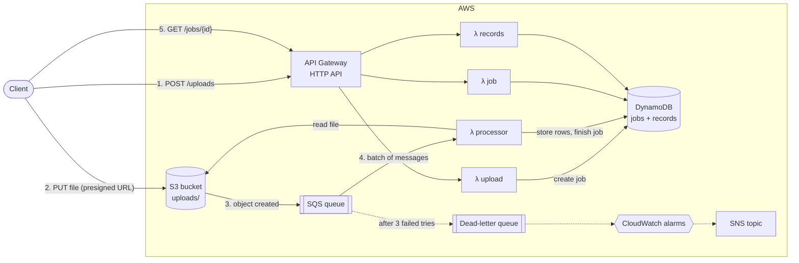

# Serverless CSV Ingestion Pipeline on AWS

[](https://github.com/ramtejeswar/aws-serverless-csv-pipeline/actions/workflows/ci.yml)


An event-driven pipeline that ingests CSV files of orders. A client uploads a file straight to S3, a queue-driven worker validates every row in the background, valid rows are stored in DynamoDB, and the client polls an API for the outcome. It is built from managed AWS services and deployed with Terraform.



## What it does

1. `POST /uploads` creates a job and returns a **presigned URL**.
2. The client `PUT`s the CSV to that URL. The file goes directly to a private S3 bucket.
3. S3 sends an "object created" event to an **SQS queue**.
4. The **processor** Lambda reads the file, validates each row, stores the valid rows, and records how many rows were accepted and rejected, with the reason for the first 20 rejections.
5. The client polls `GET /jobs/{id}` until the job finishes, then pages through `GET /jobs/{id}/records`.

## Features

- **Asynchronous processing**: uploads return immediately and the work happens in the background, so large files never hit API timeouts.
- **Reliable by design**: failed messages are retried, then moved to a dead-letter queue after 3 attempts. One bad message never blocks or re-runs the rest of its batch.
- **Idempotent**: the same file processed twice gives the same result, which matters because SQS delivers messages at least once.
- **Row-level validation**: bad rows are reported with their line number, and good rows are still stored.
- **Least-privilege IAM**: four functions, four roles, each limited to the exact actions and resources it uses.
- **Private storage**: the bucket blocks all public access. Uploads use short-lived presigned URLs that allow writing one specific object.
- **Self-cleaning**: files expire through an S3 lifecycle rule and data through DynamoDB TTL, both after 7 days.
- **Monitored**: CloudWatch alarms on the dead-letter queue and on queue backlog notify an SNS topic, with an optional email subscription.
- **Tested**: 54 unit tests against in-memory DynamoDB and S3 (moto), plus an end-to-end smoke test for real deployments. CI runs the tests and `terraform validate` on every push.

## API

| Method | Path | Request | Response |
|---|---|---|---|
| `POST` | `/uploads` | `{"filename": "orders.csv"}` (optional) | `201` `{job_id, upload_url, status_url, ...}` |
| `PUT` | the `upload_url` | the CSV file as the body | `200` from S3 |
| `GET` | `/jobs/{job_id}` | | `200` `{status, total_rows, valid_rows, error_rows, errors, ...}` · `404` |
| `GET` | `/jobs/{job_id}/records` | `?limit=25&next=<token>` | `200` `{records, next}` · `404` |

Job status moves `PENDING_UPLOAD` → `PROCESSING` → `COMPLETED`, `COMPLETED_WITH_ERRORS` or `FAILED`.

```bash
$ curl -s -X POST "$API/uploads" -d '{"filename": "orders.csv"}'
{"job_id": "0b8e...", "upload_url": "https://csv-pipeline-dev-uploads-....s3.us-east-1.amazonaws.com/uploads/0b8e....csv?X-Amz-...",
 "upload_expires_in": 300, "max_bytes": 5242880, "status_url": "https://.../jobs/0b8e..."}

$ curl -s -X PUT --upload-file samples/orders.csv "<upload_url>"

$ curl -s "$API/jobs/0b8e..."
{"job_id": "0b8e...", "status": "COMPLETED_WITH_ERRORS", "total_rows": 10, "valid_rows": 5, "error_rows": 5,
 "errors": [{"line": 5, "error": "customer_email is not a valid email address"}, ...]}
```

### File format

UTF-8 CSV with a header row, up to 5 MB and 10,000 rows. Extra columns are ignored.

| Column | Rule |
|---|---|
| `order_id` | 1-64 letters, digits, `-` or `_`; unique within the file |
| `customer_email` | a valid email address |
| `amount` | greater than 0, at most 2 decimal places |
| `currency` | 3-letter uppercase code, e.g. `USD` |
| `order_date` | a real date as `YYYY-MM-DD` |

[`samples/orders.csv`](samples/orders.csv) has 5 valid rows and 5 rows that each break a different rule.

## Quick start

**You need:** an AWS account with the CLI configured (an IAM user, not root), Terraform 1.5 or newer, Python 3.13, and `make`.

```bash
make install    # virtualenv + test dependencies
make test       # 54 unit tests, no AWS account needed
make plan       # preview: about 40 resources to create
make deploy     # runs tests again, then terraform apply
make smoke      # uploads the sample file to the live stack and checks the result
make destroy    # remove everything when you're done
```

To get alarm emails, copy `infra/terraform.tfvars.example` to `infra/terraform.tfvars` and set `alert_email`. The [runbook](docs/RUNBOOK.md) covers logs, the dead-letter queue, troubleshooting and teardown.

## Project layout

```
├── src/pipeline/
│   ├── api.py              HTTP handlers: create upload, job status, list records
│   ├── processor.py        SQS-triggered worker
│   ├── orders.py           CSV columns and row validation (pure Python)
│   ├── store.py            DynamoDB access (single-table design)
│   ├── storage.py          S3 access and presigned URLs
│   └── http.py             API Gateway event/response helpers
├── tests/                  pytest + moto
├── infra/                  Terraform
│   ├── locals.tf           the function map: handlers, routes, permissions
│   ├── storage.tf          DynamoDB table, S3 bucket, lifecycle, notifications
│   ├── queue.tf            SQS queue, dead-letter queue, Lambda trigger
│   ├── lambda.tf           functions, per-function IAM roles, log groups
│   ├── api.tf              HTTP API, routes, throttling, access logs
│   └── monitoring.tf       SNS topic and CloudWatch alarms
├── samples/orders.csv      example file with good and bad rows
├── scripts/smoke_test.sh   end-to-end test for a deployed stack
└── docs/                   architecture, design decisions, runbook, roadmap
```

## Cost

Every service here is billed per use, with no instances running. At personal-project volume it should stay within or near the AWS Free Tier. Two things run while the stack is idle: Lambda polls the queue, which uses part of the SQS free request allowance, and the two CloudWatch alarms count against the free alarm allowance. Run `make destroy` when you are not using it.

## Documentation

- [Architecture](docs/ARCHITECTURE.md): components, flows, data model, IAM, failure handling
- [Design decisions](docs/DECISIONS.md): why each choice was made and what it trades off
- [Runbook](docs/RUNBOOK.md): deploy, verify, debug, handle the dead-letter queue, tear down
- [Roadmap](docs/ROADMAP.md): planned improvements

