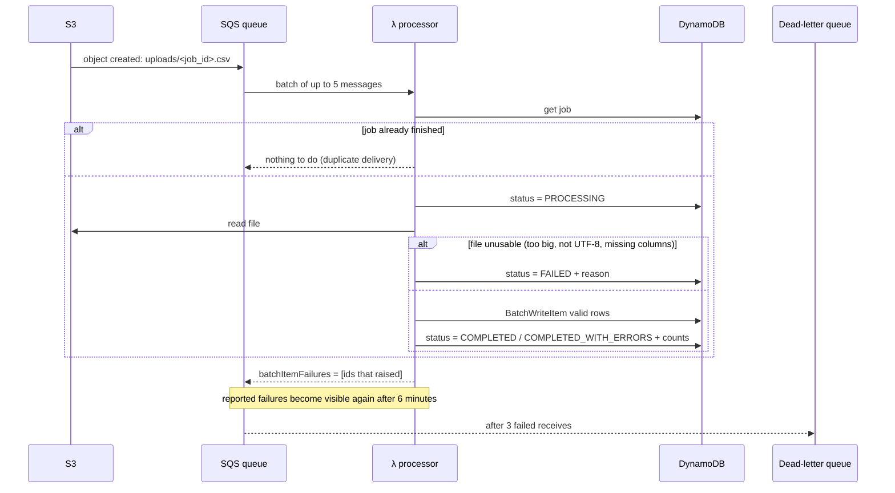

# Architecture

## Components

| Component | AWS service | Responsibility |
|---|---|---|
| API | API Gateway HTTP API | Routing, throttling (10 rps / 20 burst), access logs |
| `upload` function | Lambda, 128 MB | Create the job, sign an upload URL |
| `job` function | Lambda, 128 MB | Return a job's status and counts |
| `records` function | Lambda, 128 MB | Return a page of a job's stored rows |
| Upload bucket | S3, private | Hold uploaded files for 7 days; emit "object created" events |
| Upload queue | SQS standard queue | Buffer work, retry failures |
| Dead-letter queue | SQS | Hold messages that failed 3 times, for 14 days |
| `processor` function | Lambda, 256 MB, 60 s | Validate a file and store its rows |
| Data table | DynamoDB on-demand | Jobs and records, auto-deleted after 7 days by TTL |
| Alerts | CloudWatch alarms + SNS | Notify when processing fails or falls behind |

All four functions deploy the same zip of `src/` and point at different handlers. Terraform builds each function, role and log group from the `functions` map in [`infra/locals.tf`](../infra/locals.tf).

## Why the upload does not go through the API

API Gateway accepts request bodies up to 10 MB and Lambda up to 6 MB, and both bill for the time spent relaying bytes. A **presigned URL** avoids all of that: the `upload` function signs a URL with its own credentials that permits one action (`PutObject`) on one key (`uploads/<job_id>.csv`) for 5 minutes. The client sends the file straight to S3, and the bucket never becomes public.

## The processing flow

### Two kinds of failure

| Kind | Example | What happens |
|---|---|---|
| **Permanent**: the file itself is bad | Missing columns, not UTF-8, over 5 MB, no valid rows | Job marked `FAILED` with a reason. The message is deleted; retrying would not help. |
| **Transient**: something around it failed | DynamoDB throttling, a timeout, a bug | The message returns to the queue and is retried. After 3 attempts it moves to the dead-letter queue and an alarm fires. |

Telling these apart is the core of the worker's design. Retrying a permanently bad file wastes three invocations and raises a false alarm; failing a job on a temporary glitch loses work that a retry would have completed.

### Idempotency

SQS standard queues deliver each message **at least once**, and S3 can occasionally send duplicate events. Processing the same file again must therefore leave the same end state:

- Records are keyed by `order_id`, so writing them again overwrites the same items.
- Job counts are **set** to totals, never incremented.
- A job that already finished is skipped.

### Partial batch failures

The processor receives up to 5 messages per invocation. If it raised an exception, SQS would retry all 5, including the ones that succeeded. Instead it catches errors per message and returns `{"batchItemFailures": [...]}`, so only the failed messages are retried.

## Data model

One table, `<project>-<env>-data`, with partition key `pk` and sort key `sk`:

| `pk` | `sk` | Item |
|---|---|---|
| `JOB#<job_id>` | `META` | The job: `status`, `filename`, timestamps, `total_rows`, `valid_rows`, `error_rows`, `errors` |
| `JOB#<job_id>` | `ORDER#<order_id>` | One valid row: `customer_email`, `amount`, `currency`, `order_date` |

A job and its records share a partition key, so the two access patterns are each one call:

- **Job status**: `GetItem` on `(JOB#id, META)`.
- **A job's records**: `Query` where `pk = JOB#id` and `sk begins_with ORDER#`, with `Limit` and `ExclusiveStartKey` for paging.

Every item has `expires_at` (epoch seconds), and DynamoDB TTL deletes items after that time.

### Pagination

DynamoDB returns a `LastEvaluatedKey` when more results remain. The API encodes it as an opaque `next` token. On the way back in, the token is checked to belong to the requested job before it is passed to DynamoDB, so it cannot be used to read another job's partition.

## Security model

| Function | May do |
|---|---|
| upload | `dynamodb:PutItem` on the table; `s3:PutObject` on `uploads/*` (needed to sign URLs) |
| job | `dynamodb:GetItem` |
| records | `dynamodb:GetItem`, `dynamodb:Query` |
| processor | `sqs:ReceiveMessage/DeleteMessage/GetQueueAttributes` on the queue; `s3:GetObject` on `uploads/*`; `dynamodb:GetItem/UpdateItem/BatchWriteItem` |

Each also writes to its own log group only.

**Resource-based policies:**
- The queue accepts `SendMessage` only from S3, only for this bucket, only from this account.
- Each API function accepts invocations only from this API.

**Other protections:**
- The bucket blocks all public access and is encrypted at rest (S3 default).
- Job ids are random UUIDs, and only object keys matching `uploads/<uuid>.csv` with an existing job are processed.
- File size and row count are capped in the worker.

**Not included:** authentication. Anyone with the API URL can create uploads, and anyone with a job id can read that job (see the [roadmap](ROADMAP.md)).

## Observability

- **Function logs**: `/aws/lambda/<project>-<env>-<function>`, JSON format. Worker events: `job_finished`, `job_failed`, `duplicate_delivery_skipped`, `object_without_job`, `message_failed`.
- **API access logs**: `/aws/apigateway/<project>-<env>-access`.
- **Alarms**, both publishing to the SNS topic:
  - `dlq-not-empty`: a message reached the dead-letter queue.
  - `queue-backlog`: the oldest message has waited more than 10 minutes.
